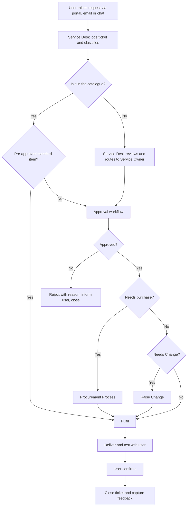
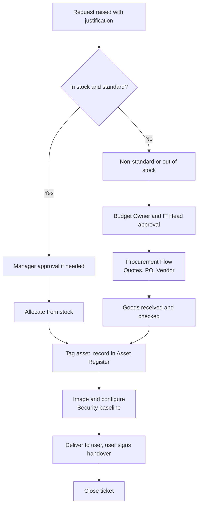
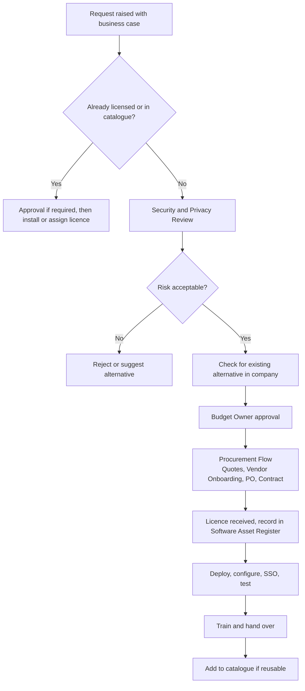
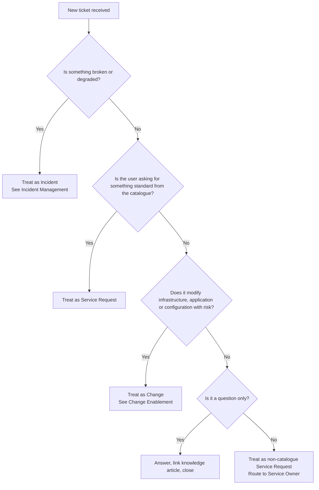
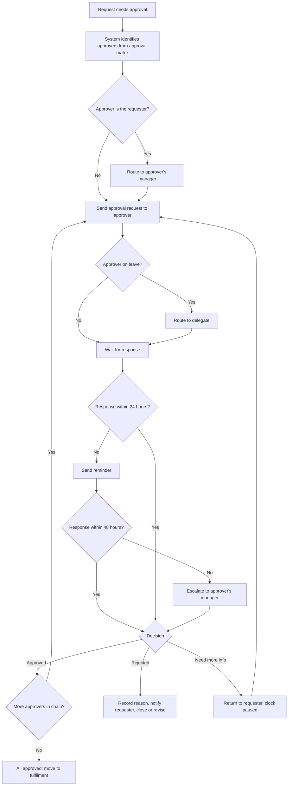
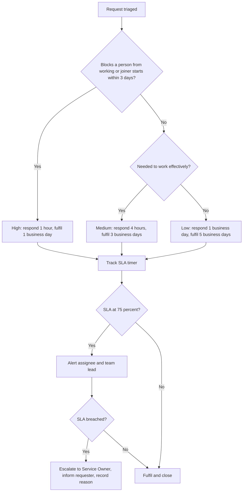

# 1. Service Request Management

> **Purpose:** Make it easy for people to ask for what they need, make sure the right people approve it, and deliver it on time without chasing.

---

## 1.1 What Is a Service Request?

A service request is a **planned, expected ask** from a user. Nothing is broken. They simply need something.

If something is broken, it is an **Incident** (see [Incident Management](03-incident-management.md)).
If the ask changes the environment in a risky way, it may also need a **Change** (see [Change Enablement](04-change-enablement.md)).

---

## 1.2 Types of Requests

| Category | Examples | Typical Fulfilment Time* |
|----------|----------|--------------------------|
| **Access** | New account, shared mailbox, application access, VPN, folder permission, admin rights | 1 business day |
| **Hardware (standard)** | Laptop, monitor, keyboard, docking station, headset, mobile phone from the approved catalogue | 3 to 5 business days (stock) |
| **Hardware (non-standard)** | High-spec workstation, specialised devices, lab equipment | Follows [Procurement](02-procurement-and-vendor-onboarding.md) |
| **Software (standard)** | Tools from the approved software catalogue (Office suite, browser, PDF tools, etc.) | 1 to 2 business days |
| **Software (new / non-catalogue)** | New SaaS tool, licensed software, developer tools, plugins | Security review plus [Procurement](02-procurement-and-vendor-onboarding.md) |
| **Employee lifecycle** | New joiner setup, role change, leaver | See [JML](06-joiner-mover-leaver-and-access.md) |
| **Information / How-to** | "How do I connect to the printer?" | Same day |
| **Environment / Infrastructure** | New server, VM, cloud resource, firewall rule, DNS entry, certificate | Normally raises a Change |
| **Data** | Report extract, backup restore, mailbox recovery | 1 to 3 business days |
| **Event / Meeting support** | AV setup, video conference room, townhall support | As scheduled |

*Examples only. Set to what your team can actually deliver, then improve.

---

## 1.3 The Standard Request Flow

### Step by Step

1. **Raise:** User submits through the portal (preferred), email, or chat. The ticket is created automatically.
2. **Triage:** Service Desk checks that the request is complete: what, why, who for, by when, cost centre.
3. **Classify:** Catalogue item or custom. Standard or non-standard.
4. **Approve:** Follows the approval matrix below.
5. **Fulfil:** Right team picks it up. If purchase is involved, handover to procurement flow.
6. **Verify:** Requester confirms it works.
7. **Close:** Ticket is closed only after confirmation (or auto-closed after 3 business days of no response).
8. **Feedback:** One-click satisfaction rating.

---

## 1.4 Approval Matrix

Approvals should be **proportionate to risk and cost**. Do not make people wait for approvals that add nothing.

| Request Type | Approval Needed | Notes |
|--------------|-----------------|-------|
| Standard, pre-approved items (e.g., approved software, replacement keyboard) | **None** | Pre-approved by IT and Finance at catalogue level |
| Standard hardware for new joiner | **HR confirmation** (joiner form) | Budget already allocated |
| Standard hardware, replacement or upgrade | **Line Manager** | Check refresh policy |
| Application access (normal) | **Line Manager** plus **Application Owner** | |
| Application access (sensitive: finance, HR, production, customer data) | Line Manager plus Application Owner plus **Security / Data Owner** | Time-bound where possible |
| Admin / privileged access | Line Manager plus **IT Head** plus **Security** | Time-boxed and logged |
| Non-catalogue software (free) | Line Manager plus **Security review** | Check licence, data privacy |
| Non-catalogue software (paid) | Line Manager plus Budget Owner plus Security plus IT Head | Goes to [Procurement](02-procurement-and-vendor-onboarding.md) |
| Non-standard hardware | Line Manager plus Budget Owner plus IT Head | Goes to Procurement |
| Server / cloud resource | Line Manager plus Service Owner plus **Change approval** | Cost visibility mandatory |
| Firewall / network rule | Service Owner plus **Security** plus Change approval | |
| Data restore / bulk data extract | Data Owner | Logged and auditable |

### Approval Rules

- Approvers get **48 business hours** to respond. After 24 hours they get a reminder, and after 48 hours it escalates to their manager.
- Approvers **cannot approve their own requests**.
- If an approver is on leave, a **delegate** must be set in the tool.
- Every approval and rejection is **recorded in the ticket** with a comment.
- Emergency requests can be verbally approved by a Director but must be **recorded in writing within 24 hours**.

---

## 1.5 Priority for Requests

Requests use a simpler scale than incidents.

| Priority | When | Response | Target Fulfilment |
|----------|------|----------|-------------------|
| **High** | Blocks a person from working, or a new joiner starts within 3 days | 1 business hour | 1 business day |
| **Medium** | Needed to work effectively, no workaround required | 4 business hours | 3 business days |
| **Low** | Nice to have, can wait | 1 business day | 5 business days |

> If someone asks for something urgent that is really a **fault**, convert it to an Incident.

---

## 1.6 New Hardware Request, End to End

## 1.7 New Software Request, End to End

### Software Review Checklist

- Does the business really need it? Do we already own something similar?
- Where is the data stored? Which country?
- Does it support **SSO and MFA**?
- Does it hold personal or confidential data? (If yes, DPA required.)
- Vendor security certification (ISO 27001, SOC 2, etc.)?
- Licence model: per user, per device, or usage based?
- Exit plan: how do we get our data out if we leave?

---

## 1.8 Roles in Service Requests

| Role | Responsibility |
|------|----------------|
| **Requester** | Gives clear details, confirms delivery |
| **Service Desk** | Logs, classifies, tracks, keeps the user updated |
| **Approver** | Decides within SLA, gives a reason if rejecting |
| **Fulfilment Team** | Delivers the request |
| **Service Owner** | Owns the catalogue item, keeps it current |
| **Procurement / Finance** | Handles purchase requests |

---

## 1.9 Quality Rules

- A user should **never have to ask for a status**. We update them proactively.
- Every catalogue item has an **owner**, **SLA**, **approval path**, and **fulfilment steps** documented.
- Review the catalogue **every quarter**. Remove what nobody asks for, add what everybody asks for.

---

## 1.10 Additional Flowcharts

### A. First Question: Is It a Request, an Incident, or a Change?

The Service Desk uses this quick check on every new ticket so it lands in the right process.

### B. Approval Workflow (With Reminders and Escalation)

### C. Request Priority and SLA Handling

