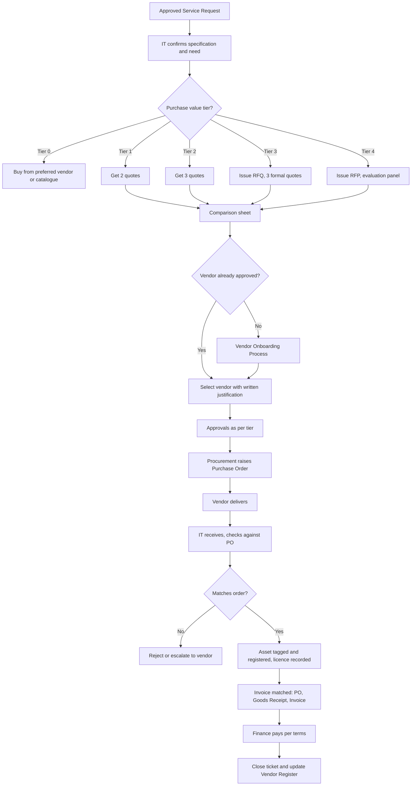
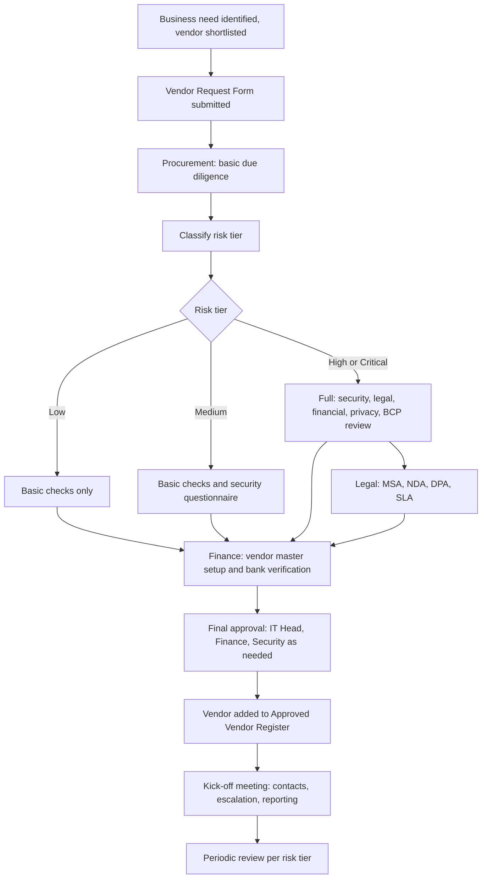
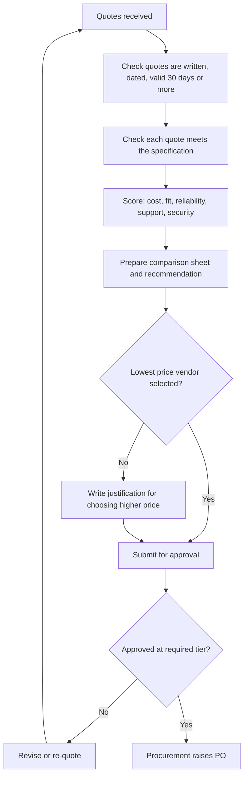
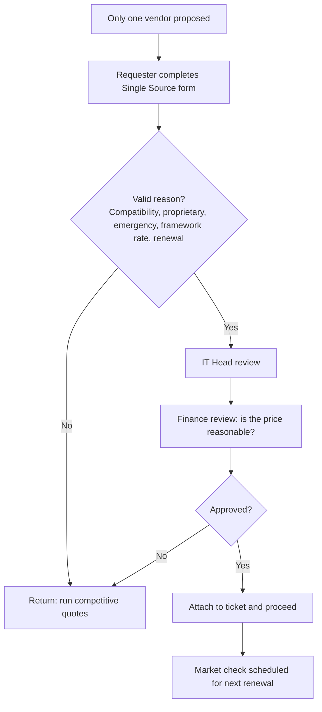
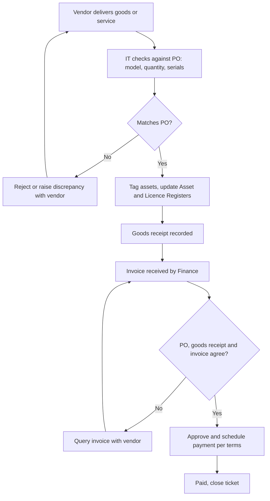
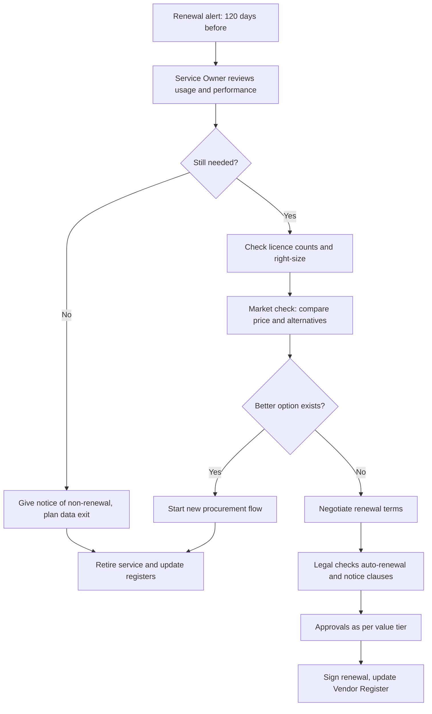
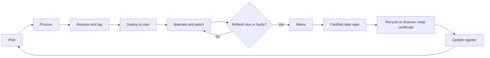

# 2. Procurement and Vendor Onboarding

> **Purpose:** Buy the right thing, from the right vendor, at the right price, with the right approvals, and with a clear paper trail. This is where IT earns (or loses) the trust of Finance and Audit.

---

## 2.1 Golden Rules

1. **No purchase without an approved request.** No "I'll sort it and claim later."
2. **Separate the duties.** The requester, approver, buyer, receiver, and payer should be different people wherever possible.
3. **Competition keeps us honest.** Quotes are required above defined thresholds.
4. **Know who you are buying from.** Every new vendor is vetted before the first purchase order.
5. **Contracts are signed by authorised signatories only.** IT staff do not sign unless they hold delegated authority.
6. **Every asset and every licence is recorded the day it arrives.**

---

## 2.2 Purchase Approval and Quote Thresholds

> The values below are **examples in USD-equivalent**. Replace with values that suit your organisation. Small companies can merge tiers.

| Tier | Purchase Value | Quotes Needed | Approvers | Extra Requirements |
|------|----------------|---------------|-----------|--------------------|
| **Tier 0** | Up to $500 | None. Use catalogue or preferred vendor price | Line Manager | Card or PO |
| **Tier 1** | $501 to $5,000 | **Minimum 2 quotes** (or preferred vendor with contract rate) | Line Manager plus Budget Owner | PO required |
| **Tier 2** | $5,001 to $25,000 | **Minimum 3 written quotes** | Budget Owner plus IT Head plus Finance Manager | PO plus basic vendor review |
| **Tier 3** | $25,001 to $100,000 | **3 formal quotes via RFQ** with comparison sheet | IT Head plus Finance Head plus Department Director | Full vendor onboarding, legal review of contract |
| **Tier 4** | Above $100,000, or multi-year, or strategic | **Formal RFP / tender**, scoring matrix, evaluation panel | CIO / CFO plus Executive Committee (as per delegation of authority) | Full due diligence, security, legal, risk assessment |

### When Can We Skip the 3-Quote Rule?

Only with a documented **Single Source Justification**, approved by IT Head and Finance. Valid reasons:

- Existing platform, and a different product would not be compatible
- Proprietary product with only one supplier
- Genuine emergency (to restore a critical service)
- Pre-negotiated rate card or framework agreement already in place
- Continuing support or renewal of existing service (with a market check every 3 years)

### How to Compare Quotes (Not Just Price)

| Criterion | Suggested Weight |
|-----------|------------------|
| Total cost of ownership (purchase, support, renewal, training) | 35% |
| Fit to requirement | 25% |
| Vendor reliability and references | 15% |
| Support and SLA | 15% |
| Security and compliance | 10% |

The comparison sheet is attached to the ticket. The cheapest quote is not always the winner, but if we pick a more expensive one, we write down why.

---

## 2.3 Purchase Flow (Hardware and Software)

### Step by Step

1. **Approved request:** No approved request, no purchase.
2. **Specification:** IT writes a clear spec (what, how many, minimum requirements, support needs).
3. **Quotes:** Follow the tier table above. Quotes must be written, dated, and valid for at least 30 days.
4. **Comparison:** Fill the comparison sheet. Attach to ticket.
5. **Vendor check:** If vendor is new, run [Vendor Onboarding](#24-vendor-onboarding).
6. **Approval:** Obtain approvals for the tier.
7. **Purchase Order:** Procurement or Finance raises the PO. IT never places an order without a PO number.
8. **Receipt:** IT checks the delivery against the PO (quantity, model, serial numbers).
9. **Registration:** Asset tag applied. Hardware goes to the Asset Register. Software goes to the Licence Register with expiry and renewal date.
10. **Three-way match:** Finance matches PO, goods receipt, and invoice.
11. **Payment:** Per agreed terms.

---

## 2.4 Vendor Onboarding

### Why We Take This Seriously

A vendor with access to our data, systems, or customers is an extension of our team. If they fail, we fail. Good onboarding is cheaper than a bad surprise.

### Vendor Risk Tiers

| Risk Tier | Definition | Examples |
|-----------|------------|----------|
| **Critical** | Supports a critical service, holds sensitive data, or is hard to replace | Cloud provider, ERP, core network carrier, payroll system |
| **High** | Access to internal systems or personal data | SaaS platform with user data, managed service provider |
| **Medium** | Limited access, replaceable | Software tools, consultants with limited access |
| **Low** | No data or system access | Cables, peripherals, one-off consumables |

### Onboarding Flow

### Due Diligence Checklist

**Company and Finance**
- Registered company details, address, years in business
- Tax registration and relevant compliance documents
- Financial health (annual reports, credit check for Tier 3+)
- Bank details verified through **call-back to a known number** (never trust only an emailed change of bank details)
- Conflict of interest declaration (no personal relationship with our staff, or disclosed)

**Security and Privacy**
- Security questionnaire completed
- Certifications (ISO 27001, SOC 2 Type II, etc.)
- Where is our data stored, and who can access it?
- Encryption in transit and at rest
- Incident notification commitment (for example, tell us within 24 to 72 hours)
- Sub-processors list
- Right to audit

**Legal and Commercial**
- NDA signed before sharing any internal information
- MSA with clear scope, liability, and termination terms
- DPA where personal data is involved
- SLA with response and resolution targets, and service credits
- Exit clause and data return or deletion terms
- Insurance (professional indemnity, cyber) for higher-risk vendors

**Operational**
- Named account manager and escalation matrix
- Support hours and channels
- Business continuity and disaster recovery information
- Reference checks (at least 2 for Tier 3+)

### Approvals for New Vendors

| Risk Tier | Approvers |
|-----------|-----------|
| Low | Procurement |
| Medium | Procurement plus IT Head |
| High | Procurement plus IT Head plus Security plus Finance |
| Critical | All above plus Legal plus CIO / CFO |

### Ongoing Vendor Management

| Risk Tier | Review Frequency |
|-----------|------------------|
| Critical | Quarterly performance review, annual risk reassessment |
| High | Half-yearly review, annual risk reassessment |
| Medium | Annual review |
| Low | Review on renewal |

Track: SLA performance, number of incidents, invoicing accuracy, security issues, and relationship health.

---

## 2.5 Contract and Renewal Management

- Every contract is stored in a central, access-controlled repository.
- Renewal date, notice period, and owner are recorded in the Vendor Register.
- **Alert 120 days before renewal** (or 2x the notice period) so we can renegotiate, replace, or cancel.
- At renewal, check: Are we still using it? Are we paying for unused licences? Is the price fair compared to the market?
- Auto-renewal clauses are **flagged** and reviewed by Legal.

---

## 2.6 Asset and Licence Lifecycle

| Stage | Action |
|-------|--------|
| **Plan** | Forecast needs yearly, align to budget |
| **Procure** | As per this document |
| **Receive** | Check, tag, register |
| **Deploy** | Image, secure, assign to user, record |
| **Maintain** | Warranty, patching, support |
| **Refresh** | Typically laptops every 3 to 4 years (set your own policy) |
| **Retire** | Wipe data (certified), recycle or dispose, update register, collect certificate |

- Quarterly **reconciliation** of the Asset Register with physical stock and procurement records.
- Annual **software licence audit** to avoid both over-spend and non-compliance.

---

## 2.7 Red Flags (Stop and Escalate)

- Vendor pushes urgency to bypass the process
- Request to change bank details by email
- Quote splitting (breaking a purchase into smaller bits to avoid a tier)
- A staff member has a personal relationship with the vendor and has not declared it
- Quotes that look copied, from related companies, or suspiciously similar
- Vendor refuses to complete security review but wants system access

---

## 2.8 Roles

| Role | Responsibility |
|------|----------------|
| **Requester** | Provides need and justification |
| **IT Lead / Service Owner** | Specification, technical evaluation, recommendation |
| **Procurement** | Quotes, vendor onboarding, PO, negotiation |
| **Finance** | Budget check, vendor master data, payment |
| **Security** | Risk review of vendor and product |
| **Legal** | Contract review |
| **Approvers** | As per tier |
| **IT Asset Manager** | Registers and tracks assets and licences |

---

## 2.9 Additional Flowcharts

### A. Which Quote Rule Applies? (Decision Flow)

```mermaid
flowchart TD
    A[Approved request needs a purchase] --> B{Purchase value}
    B -- Up to 500 --> T0[Tier 0: catalogue or preferred vendor<br/>Approver: Line Manager]
    B -- 501 to 5,000 --> T1[Tier 1: 2 quotes<br/>Approvers: Manager and Budget Owner]
    B -- 5,001 to 25,000 --> T2[Tier 2: 3 written quotes<br/>Approvers: Budget Owner, IT Head, Finance Manager]
    B -- 25,001 to 100,000 --> T3[Tier 3: RFQ with 3 formal quotes<br/>Approvers: IT Head, Finance Head, Director]
    B -- Above 100,000 or strategic --> T4[Tier 4: RFP with evaluation panel<br/>Approvers: CIO, CFO, ExCo]
    T0 --> Z[Proceed to PO]
    T1 --> Q{Can we get the required quotes?}
    T2 --> Q
    T3 --> Q
    T4 --> Q
    Q -- Yes --> C[Complete comparison sheet]
    Q -- No --> S[Single Source Justification]
    S --> SA{IT Head and Finance approve?}
    SA -- No --> R[Return and find more suppliers]
    R --> Q
    SA -- Yes --> C
    C --> Z
```

### B. Quote Evaluation and Vendor Selection

### C. Single Source Justification

### D. Goods Receipt, Three-Way Match and Payment

### E. Contract Renewal

### F. Asset Lifecycle

