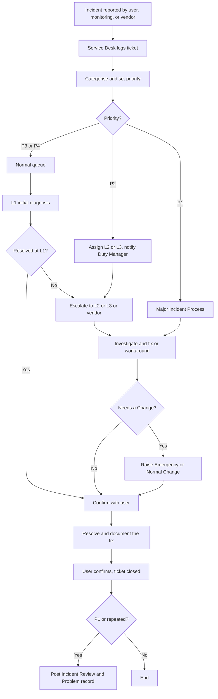
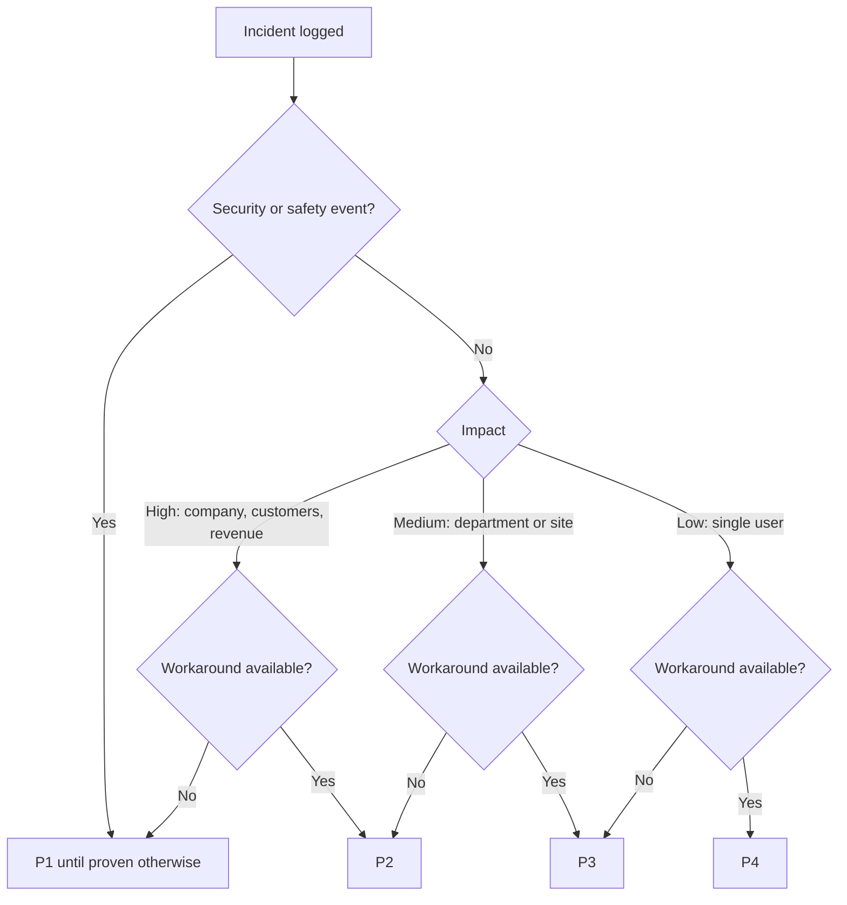
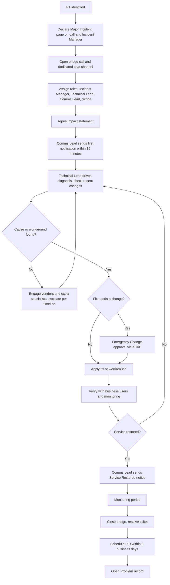
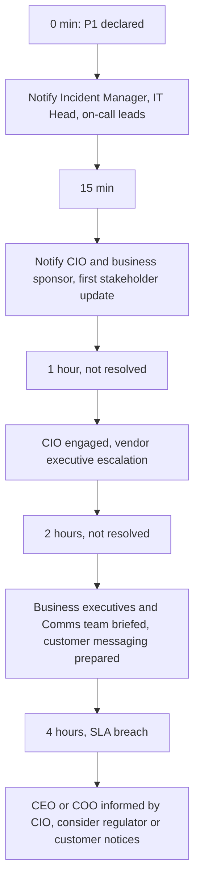
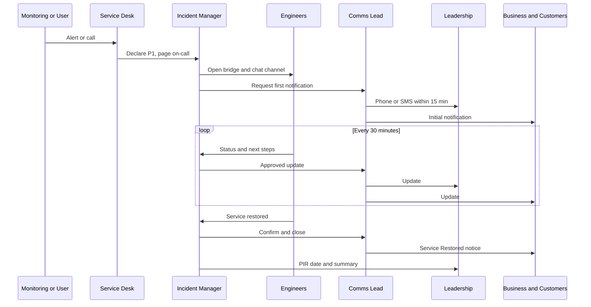
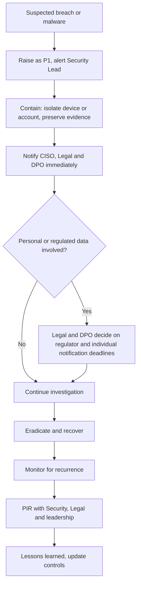
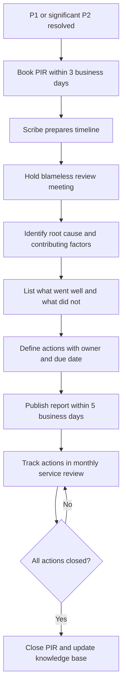

# 3. Incident Management

> **Purpose:** Restore normal service as quickly as possible, keep everyone informed, and learn from what happened. In an incident, **calm, clear communication matters as much as the technical fix.**

---

## 3.1 What Is an Incident?

An unplanned interruption to a service, or a reduction in its quality. Examples: email is down, VPN is slow, an application throws errors, a laptop will not start, suspected malware.

---

## 3.2 How We Decide Priority

Priority = **Impact** (how many people or how much business is affected) x **Urgency** (how quickly it hurts).

| | **Urgency: High** (no workaround, business stopped) | **Urgency: Medium** (workaround exists) | **Urgency: Low** (minor annoyance) |
|---|---|---|---|
| **Impact: High** (company wide, customers, revenue, or safety) | **P1** | **P2** | **P3** |
| **Impact: Medium** (department or site) | **P2** | **P3** | **P4** |
| **Impact: Low** (single user) | **P3** | **P4** | **P4** |

### Priority Definitions

| Priority | Name | Plain-English Meaning | Examples |
|----------|------|----------------------|----------|
| **P1** | Critical / Major Incident | The business is stopped or at serious risk. Customers, revenue, safety, or legal exposure is affected | Core application down, network outage across the site, data breach, ransomware, payment system failure, all email down |
| **P2** | High | Significant impact on a large group or key function, but partial service exists | Major application slow or partly unavailable, a department cannot work, VPN issues for many users, key executive blocked during critical event |
| **P3** | Medium | Limited impact, workaround available | Single user cannot access an application, printer down in one area, non-critical software error |
| **P4** | Low | Minor issue, cosmetic, or a question | Slow performance on single machine, minor display bug, how-to question |

> **Security and safety incidents** (suspected breach, data leak, ransomware) are treated as **P1 by default** until proven otherwise.
> **VIP users** do not automatically raise priority. Priority is based on business impact, but the Service Desk may flag VIP tickets for a faster look.

---

## 3.3 SLA Targets (Example)

| Priority | Acknowledge | First Response | Update Frequency | Target Resolution | Support Hours |
|----------|-------------|----------------|------------------|-------------------|---------------|
| **P1** | 5 minutes | 15 minutes | Every **30 minutes** (15 for first hour) | **4 hours** | **24x7** |
| **P2** | 15 minutes | 30 minutes | Every **1 hour** | **8 hours** | 24x7 for critical services, otherwise business hours |
| **P3** | 1 hour | 4 hours | Every **1 business day** | **3 business days** | Business hours |
| **P4** | 4 hours | 1 business day | On progress | **5 business days** | Business hours |

Adjust these to match your team size and contracts. A small team may not be able to offer 24x7. In that case, be honest and define an on-call rota or vendor support for the most critical services.

---

## 3.4 Standard Incident Flow

### Key Steps

1. **Detect and log:** Every incident gets a ticket. No ticket, no tracking.
2. **Categorise:** Service, type, and affected users.
3. **Prioritise:** Use the matrix above.
4. **Initial diagnosis:** Check knowledge base, known errors, recent changes.
5. **Escalate:** Functional (to a specialist) or hierarchical (to management) as needed.
6. **Resolve:** Fix or workaround. Record what was done.
7. **Confirm:** User agrees service is back.
8. **Close:** Update knowledge base. Link to Problem if root cause is not known.

> **Always ask: "What changed recently?"** A large share of incidents are linked to a change.

---

## 3.5 Escalation Path

### Functional Escalation (Who Can Fix It)

| Level | Who | Typical Scope |
|-------|-----|---------------|
| **L1** | Service Desk | Logging, triage, known fixes, password resets |
| **L2** | Support Engineers | Technical troubleshooting, application support |
| **L3** | Specialists / Architects / Vendor | Deep technical, code, design level, vendor engagement |

### Hierarchical Escalation (Who Needs to Know)

| Trigger | Escalate To |
|---------|-------------|
| P1 declared | Incident Manager, IT Head, on-call technical leads |
| P1 not resolved in **1 hour** | CIO / Technology Director |
| P1 not resolved in **2 hours** | Business Executive Sponsor, Communications lead |
| P1 not resolved in **4 hours** (SLA breach) | CEO / COO informed by CIO, customer or regulator comms considered |
| P2 not resolved in **4 hours** | IT Head |
| P2 breach | Service Owner plus department head |
| Suspected data breach | **CISO, Legal, DPO immediately** (regulatory clocks may be ticking) |

---

## 3.6 P1 / Major Incident Process

A P1 is a team sport. The aim is to give engineers space to fix it while stakeholders stay informed.

### Roles During a P1

| Role | Responsibility |
|------|----------------|
| **Incident Manager** | Owns the process. Runs the bridge, keeps timeline, makes decisions on escalation |
| **Technical Lead** | Leads the diagnosis and fix. Directs engineers |
| **Communications Lead** | Sends all updates to stakeholders, customers, and leadership. Engineers do not do this |
| **Scribe** | Records timeline, actions, decisions, and who said what |
| **Service Owner / Business Rep** | Explains business impact, approves workarounds |
| **Vendor Liaison** | Engages vendors and tracks their response |

### First 30 Minutes (P1 Checklist)

- [ ] Ticket created and marked P1
- [ ] Incident Manager assigned
- [ ] Bridge call and dedicated channel opened
- [ ] Engineers paged and joined
- [ ] Initial impact statement agreed (what, who, since when)
- [ ] First stakeholder notification sent
- [ ] Recent changes checked
- [ ] Vendors engaged if relevant
- [ ] Next update time announced

### During the Incident

- Keep **one bridge** and **one channel**. Do not run side conversations.
- Incident Manager asks for status every **15 minutes** on the bridge.
- Decisions that carry risk (reboot, failover, rollback) are approved by the Incident Manager and Service Owner.
- Emergency changes follow the [Emergency Change](04-change-enablement.md#44-emergency-change) path.
- Stay on the fix. Hold the "why did this happen" discussion for later.

### Closing a P1

1. Service restored and verified by business users
2. Monitoring confirms stability for an agreed period
3. Final "service restored" notification sent
4. Ticket moved to Resolved
5. **Post-Incident Review (PIR) booked within 3 business days**
6. PIR report published within **5 business days**

---

## 3.7 Communication Channels by Priority

| Priority | Internal Technical | Stakeholders / Business | Leadership | Customers / External | Channel Details |
|----------|-------------------|------------------------|------------|----------------------|-----------------|
| **P1** | Dedicated chat channel (e.g., `#inc-YYYYMMDD-service`) plus **voice or video bridge** open until resolved | Email plus intranet banner plus chat announcement every 30 min | **Phone or SMS to IT Head and CIO within 15 min**, then email updates | Status page and customer email (approved by Comms/Legal), account managers briefed | Paging tool or phone for on-call. Single source of truth: the incident ticket |
| **P2** | Chat channel plus ad hoc call | Email or chat to affected department every hour | Summary email to IT Head and Service Owner | Only if customers are affected | Phone the on-call engineer if no response in 15 min |
| **P3** | Ticket updates | Ticket notifications to the user | None unless trending | None | Email and portal |
| **P4** | Ticket updates | Ticket notifications | None | None | Email and portal |

### Communication Rules

- **Say what we know, what we do not know, and when the next update is.** Even "no change, still investigating" is a useful update.
- Avoid jargon in business communications.
- Do not speculate on cause until confirmed.
- One voice: only the Communications Lead sends official updates.
- Time stamps in a single time zone (state it).
- Keep a record of every communication in the ticket.

See [Communication and Escalation Standard](07-communication-and-escalation.md) for ready-to-use templates.

---

## 3.8 Post-Incident Review (PIR)

**Purpose:** Learn, not blame. We look at the process and the system, not the person.

### When Do We Run It?

- Every P1
- Any P2 with significant impact or repeat occurrence
- Near misses that could have been serious

### PIR Agenda

1. Timeline of events (detection, response, resolution)
2. Impact (users, duration, financial, reputational)
3. Root cause (use 5 Whys or fishbone)
4. What went well
5. What did not go well
6. Detection: could we have known earlier?
7. Actions: owner, due date, and priority
8. Update knowledge base, monitoring, runbooks

### Output

A short written report, shared with IT and relevant business stakeholders. Actions are tracked to closure in the ticketing tool, and progress is reviewed in the monthly service review.

---

## 3.9 Good Habits for Incident Management

- Search the knowledge base **before** escalating
- Update the ticket as you work, not at the end
- Never close a ticket without user confirmation (or an agreed auto-close)
- Link incidents to the same root cause so Problem Management can see the pattern
- Run **simulation drills** twice a year. A P1 plan that has never been practised is just a document

---

## 3.10 Additional Flowcharts

### A. Setting the Priority

### B. P1 / Major Incident Process (Detailed)

### C. P1 Escalation Timeline

### D. P1 Communication Sequence

### E. Security Incident (Suspected Breach)

### F. Post-Incident Review

