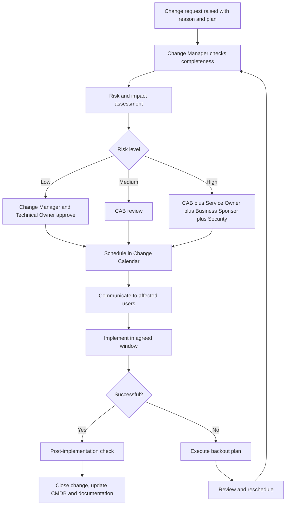
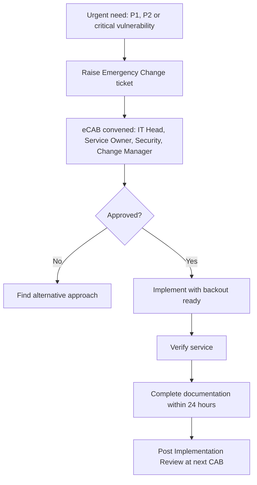
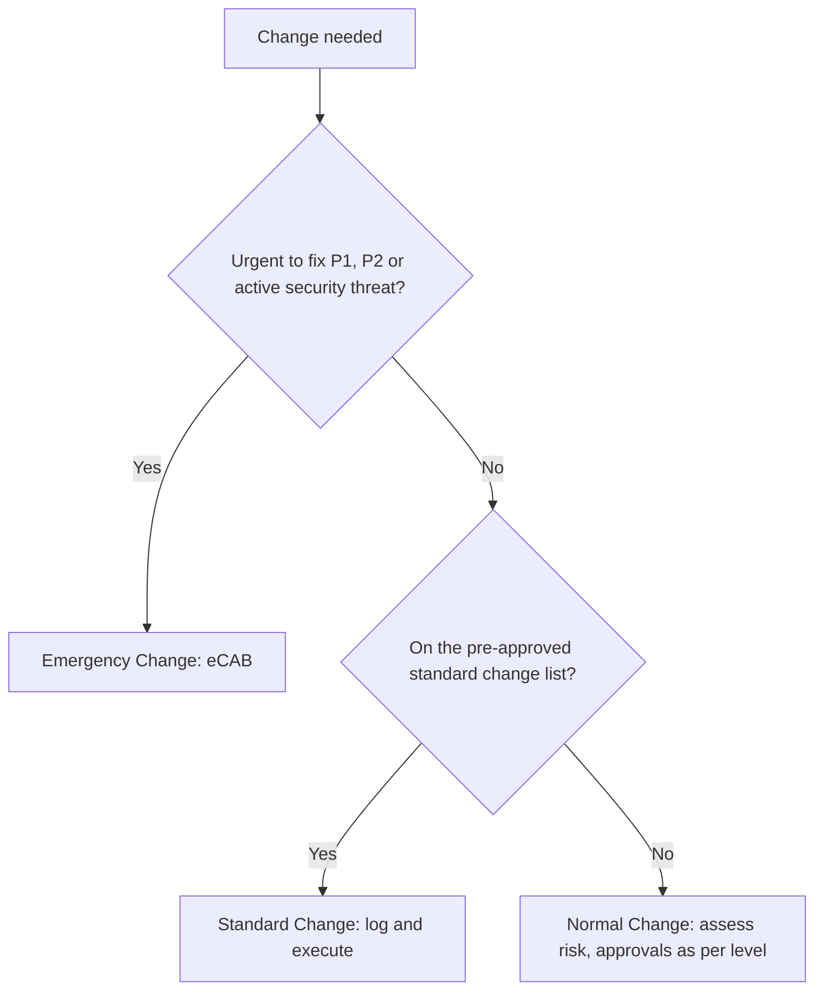
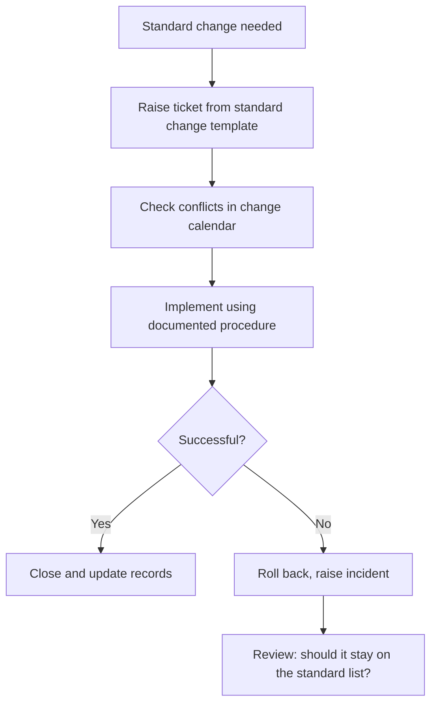
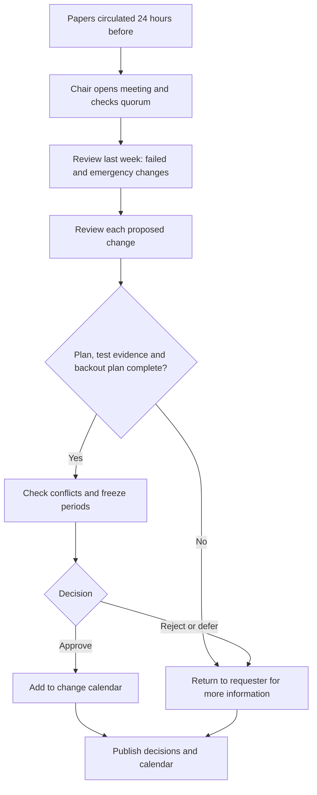
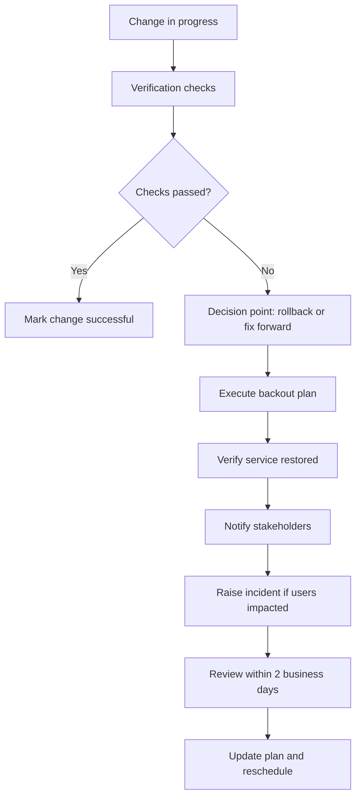

# 4. Change Enablement

> **Purpose:** Make beneficial changes happen quickly and safely. Not slowing the business down, but not breaking it either.

---

## 4.1 What Is a Change?

Anything that adds, modifies, or removes something that could affect IT services. Examples: patching, deploying a release, firewall rule, new server, configuration change, upgrading a database, migrating a mailbox platform.

---

## 4.2 Types of Change

| Type | Meaning | Approval | Examples |
|------|---------|----------|----------|
| **Standard** | Low-risk, repeatable, pre-approved with a documented procedure | **Pre-approved.** No CAB, just logged | Monthly OS patching on a tested process, adding a user to a group, standard laptop build |
| **Normal** | Needs assessment and authorisation. Risk varies | **Change Manager** (low risk), **CAB** (medium or high risk) | New application release, network change, database upgrade, new integration |
| **Emergency** | Needed urgently to fix a P1 or P2 or a critical security vulnerability | **eCAB** (a small group, fast) | Fixing a production outage, patching an actively exploited vulnerability |

---

## 4.3 Normal Change Flow

### What Every Change Request Must Include

| Item | Why It Matters |
|------|----------------|
| **Description and reason** | What are we doing and why |
| **Services and users affected** | Who might feel it |
| **Risk and impact rating** | Honest assessment |
| **Implementation plan** | Step by step, who does what |
| **Test evidence** | Proof it works in a test environment |
| **Backout / rollback plan** | How to undo it, and how long that takes |
| **Planned window** | Date, time, duration |
| **Communication plan** | Who is told, and when |
| **Approvals** | As per risk level |

### Risk Scoring (Simple Version)

| Question | Score |
|----------|-------|
| Does it affect a critical service or customer-facing system? | +3 |
| Has this exact change been done successfully before? | No = +2 |
| Is there a tested rollback? | No = +3 |
| Is it outside a standard maintenance window? | +1 |
| Does it affect more than one department or site? | +2 |
| Is it done by a team or vendor new to this system? | +2 |

**0 to 3 = Low, 4 to 7 = Medium, 8+ = High.**

---

## 4.4 Emergency Change

- Verbal approval is acceptable in the moment but must be **recorded in the ticket**.
- Emergency changes are **reviewed after the fact**. Frequent emergencies mean we need better planning.

---

## 4.5 Change Advisory Board (CAB)

| Item | Standard |
|------|----------|
| **Frequency** | Weekly (mid-size and large), fortnightly or as needed (small) |
| **Members** | Change Manager (chair), IT leads, Service Owners, Security, Service Desk rep, Business rep as needed |
| **Agenda** | Review upcoming changes, review failed or emergency changes, review the change calendar for conflicts, decide on approvals |
| **Quorum** | Chair plus at least 3 members |
| **Papers** | Circulated 24 hours before |

### Change Freeze

Agree **freeze windows** for business-critical periods (year-end close, major launches, peak trading). Only emergency changes during freeze.

---

## 4.6 Change Success Rules

- No change on Fridays at the end of the day unless it is an emergency
- Every change has a named **owner** and a **backout plan**
- Changes are **tested** before production
- Affected users are told **before**, not after
- A failed change triggers a short review within 2 business days

### Metrics

- Change success rate (target above 95%)
- Number of emergency changes
- Changes causing incidents
- Changes done without approval (target: zero)

---

## 4.7 Additional Flowcharts

### A. Which Type of Change Is It?

### B. Standard Change

### C. CAB Meeting

### D. Failed Change and Rollback

