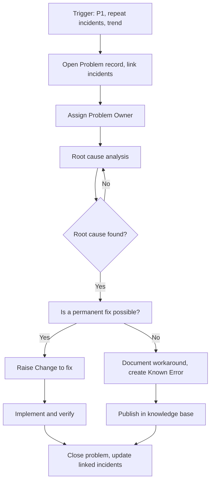
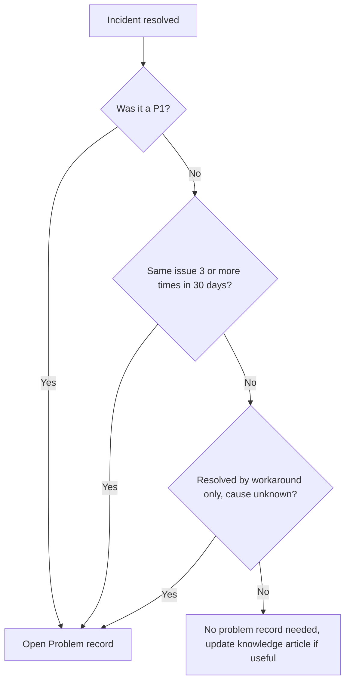
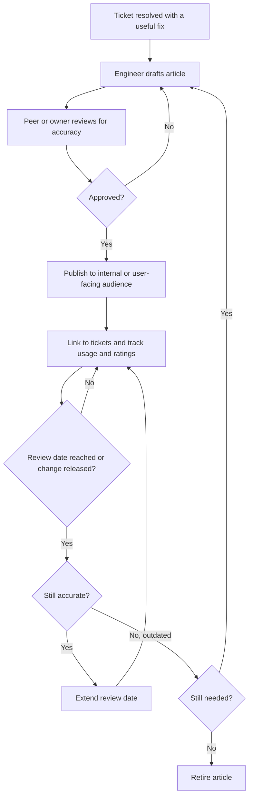

# 5. Problem and Knowledge Management

> **Purpose:** Stop firefighting the same fire. Find the real cause, fix it properly, and make sure everyone can find the answer next time.

---

## 5.1 Problem Management

**Incident** = the symptom. **Problem** = the underlying cause.

### When Do We Open a Problem?

- After every **P1**
- When the same incident type happens **3 or more times** in 30 days
- When an incident is resolved with a workaround but the cause is unknown
- When monitoring shows a worrying trend

### Flow

### Root Cause Techniques

- **5 Whys:** keep asking "why" until you reach a cause you can act on
- **Fishbone (Ishikawa):** people, process, technology, environment
- **Timeline analysis:** what changed before the issue started

### Known Error Database

A Known Error is a problem with a **documented root cause and workaround**. The Service Desk can use it instantly to resolve tickets without escalation.

| Field | Content |
|-------|---------|
| Title | Clear, searchable |
| Symptoms | What users see |
| Cause | If known |
| Workaround | Step by step |
| Permanent fix | Planned change or status |
| Owner | Named person |

### Targets

- Root cause identified for P1 within **10 business days**
- Problems reviewed weekly by the Problem Owner and monthly by IT leadership

---

## 5.2 Knowledge Management

Good knowledge articles save the team time, reduce tickets, and help users help themselves.

### Types of Articles

| Type | For | Example |
|------|-----|---------|
| **How-to** | Users | "How to connect to the VPN" |
| **Troubleshooting** | Service Desk | "Outlook keeps asking for password" |
| **Runbook** | Engineers | "Failover steps for database cluster" |
| **Known Error** | Service Desk | "App X crashes after update, workaround" |
| **Policy / Standard** | Everyone | "Password and MFA standard" |

### Article Lifecycle

1. **Draft:** anyone in IT can create, usually from a resolved ticket
2. **Review:** a peer or owner checks accuracy
3. **Publish:** to the right audience (internal or user-facing)
4. **Use:** link to tickets, track usage and ratings
5. **Review:** every **6 to 12 months**, or after a change
6. **Retire:** remove outdated content

### Quality Rules

- Plain language, short steps, screenshots where useful
- Each article has an **owner and a review date**
- "Fix something? Document it." Make it part of closing a ticket
- Measure: articles used per ticket, self-service resolution rate, outdated article count

---

## 5.3 Additional Flowcharts

### A. Do We Need a Problem Record?

### B. Knowledge Article Lifecycle

