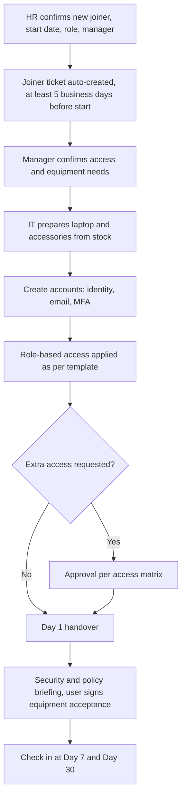
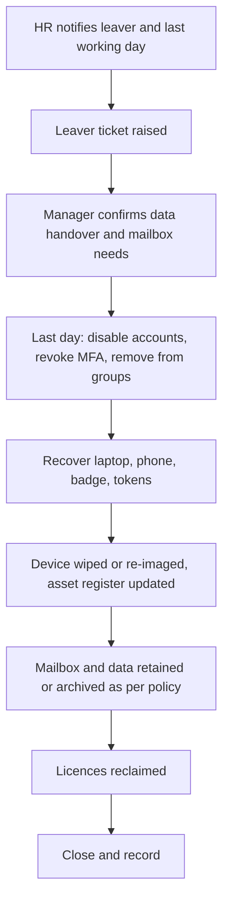
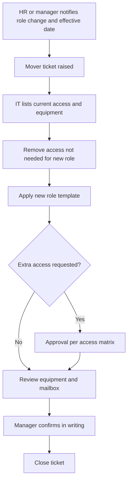
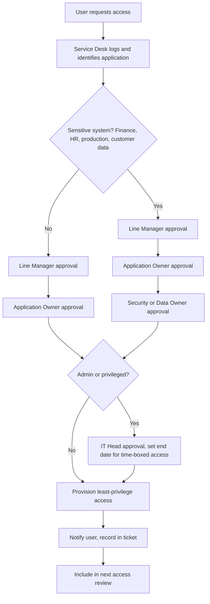
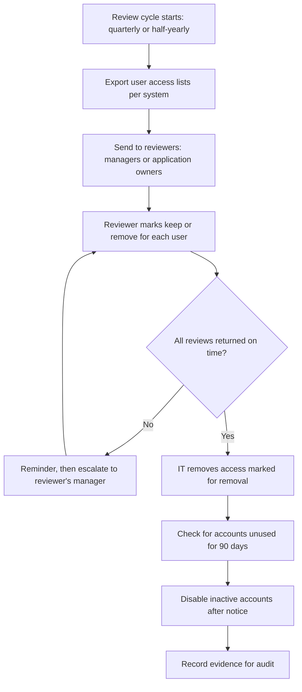

# 6. Joiner, Mover, Leaver (JML) and Access Management

> **Purpose:** Give people what they need on day one, adjust it when their role changes, and remove it cleanly when they leave. This is one of the biggest security and cost controls in IT.

---

## 6.1 Joiner (New Employee)

**Rules**
- Role-based access templates (by department or job role) keep it simple and consistent.
- New joiners get the minimum access required, nothing more.
- MFA is set up on day one.
- Hardware shortage? Raise a purchase request early, not on the morning of day one.

## 6.2 Mover (Role or Department Change)

1. HR or the manager raises the mover ticket with the effective date.
2. IT **removes access no longer needed** (this is the step most companies forget).
3. New access is granted as per the new role and approvals.
4. Equipment and mailboxes reviewed.
5. Manager confirms in writing.

## 6.3 Leaver

**Rules**
- Accounts are **disabled at the end of the last working day** (immediately for involuntary or high-risk exits).
- Never share a leaver's password. Use delegated access to mailbox if needed.
- Check for shared accounts, service accounts, and admin rights owned by the leaver.
- Leaver audit: compare HR leaver list with active directory every month.

---

## 6.4 Access Management Principles

| Principle | Meaning |
|-----------|---------|
| **Least privilege** | Only the access needed to do the job |
| **Need to know** | Sensitive data only for those with a reason |
| **Segregation of duties** | One person should not hold conflicting rights (e.g., create and approve payments) |
| **Time-bound privileged access** | Admin rights granted for a period, then removed |
| **Individual accounts** | No shared logins where avoidable |
| **MFA everywhere** | Especially remote, admin, and email |

### Periodic Access Review

| System Type | Review Frequency | Reviewer |
|-------------|------------------|----------|
| Privileged / admin accounts | Quarterly | IT Head plus Security |
| Finance, HR, and sensitive apps | Quarterly | Application Owner |
| General business apps | Every 6 months | Line Managers |
| Third-party / vendor accounts | Quarterly | Vendor owner |

Unused accounts (no login for **90 days**) are disabled after notice.

---

## 6.5 Additional Flowcharts

### A. Mover (Role or Department Change)

### B. Access Request

### C. Periodic Access Review

