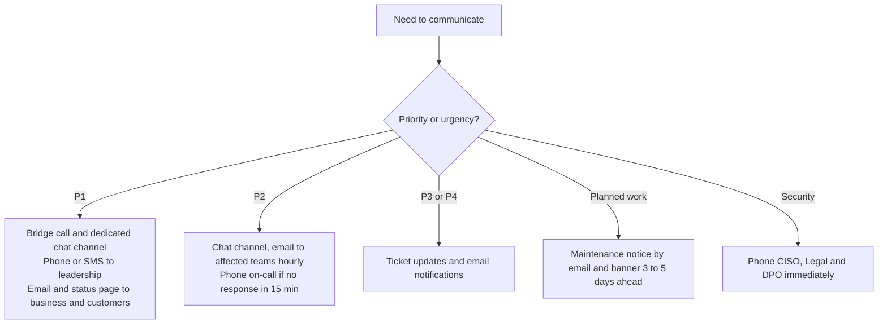
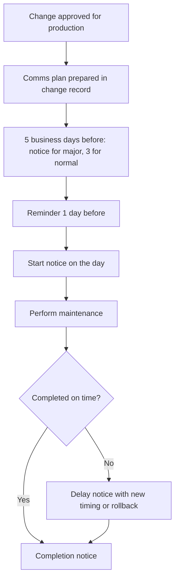
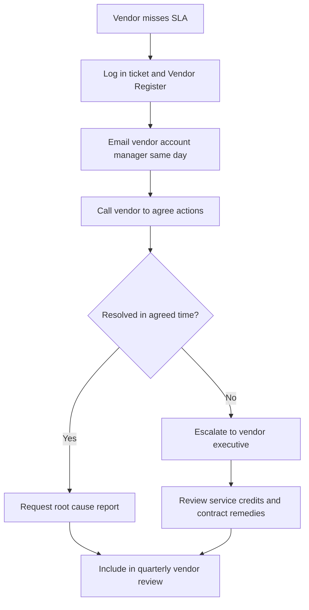

# 7. Communication and Escalation Standard

> **Purpose:** The right people, the right message, the right time, through the right channel.

---

## 7.1 Channel Guide

| Channel | Use For | Not For |
|---------|---------|---------|
| **Service Portal / Ticket** | Requests, incident tracking, approvals, status updates | Urgent P1 alerts |
| **Email** | Formal updates, approvals, summaries, vendor communication | Real-time coordination |
| **Chat (Teams, Slack, etc.)** | Team coordination, quick questions, incident channels | Approvals or decisions that need a record (copy into ticket) |
| **Voice / Video Bridge** | P1 and P2 coordination | Routine matters |
| **Phone / SMS / Paging** | Waking up on-call, notifying leadership of P1 | Routine updates |
| **Status Page / Intranet** | Company-wide or customer-facing service status | Technical detail |
| **Service Review Meeting** | Monthly performance, trends, improvement actions | Live incident handling |

---

## 7.2 Who Gets Told, and When

| Event | Who | By When | How |
|-------|-----|---------|-----|
| P1 declared | On-call engineers, Incident Manager, IT Head | Immediately | Pager, phone, bridge |
| P1 declared | CIO, business sponsor, Comms lead | Within 15 minutes | Phone or SMS, then email |
| P1 ongoing | Stakeholders | Every 30 minutes | Email plus chat |
| P1 resolved | All previously notified | Within 15 minutes of restore | Email plus status page |
| P1 PIR | Leadership and stakeholders | Within 5 business days | Written report |
| P2 declared | Service Owner, affected department | Within 30 minutes | Chat or email |
| Planned maintenance | Affected users | At least 3 business days before (5 for major) | Email plus banner |
| Emergency change | Affected users and management | As soon as approved | Email plus chat |
| Security incident | CISO, Legal, DPO | Immediately | Phone |
| Vendor SLA breach | Vendor account manager plus Service Owner | Same day | Email plus call |

---

## 7.3 Templates

### P1 Initial Notification

```
Subject: [P1] <Service> – Service Disruption – Initial Notification

Hello team,

We are currently experiencing an issue with <service>.

What is happening:  <plain description>
Who is affected:    <teams / sites / customers>
Started at:         <time and time zone>
Current status:     Investigating
What we are doing:  <short summary>
Workaround:         <if any, otherwise "None at present">
Next update:        <time>

Incident Manager: <name, contact>
Reference: <ticket number>
```

### P1 Progress Update

```
Subject: [P1] <Service> – Update #<n>

Status:         <Investigating / Fix in progress / Monitoring>
What we know:   <facts only>
What we are doing next: <actions>
Estimated resolution: <time or "not yet known">
Next update:    <time>
```

### P1 Resolved

```
Subject: [RESOLVED] [P1] <Service> – Service Restored

The issue affecting <service> was resolved at <time>.
Duration: <hh:mm>
Cause (initial): <brief, to be confirmed in review>
Next steps: Post-incident review on <date>.
Thank you for your patience.
```

### Planned Maintenance Notice

```
Subject: Planned Maintenance – <Service> – <Date>

When:    <date, start to end, time zone>
What:    <what we are doing>
Impact:  <what users will experience>
Why:     <benefit>
Contact: <Service Desk details>
```

---

## 7.4 Communication Principles

1. **Be early.** A short "we are aware and looking" is better than silence.
2. **Be plain.** Write for the reader, not the engineer.
3. **Be honest.** Do not promise a time you cannot meet.
4. **Be consistent.** Same format, same cadence.
5. **Be recorded.** Everything important ends up in the ticket.

---

## 7.5 Flowcharts

### A. Which Channel Should I Use?



### B. Planned Maintenance Communication



### C. Vendor SLA Breach Communication


