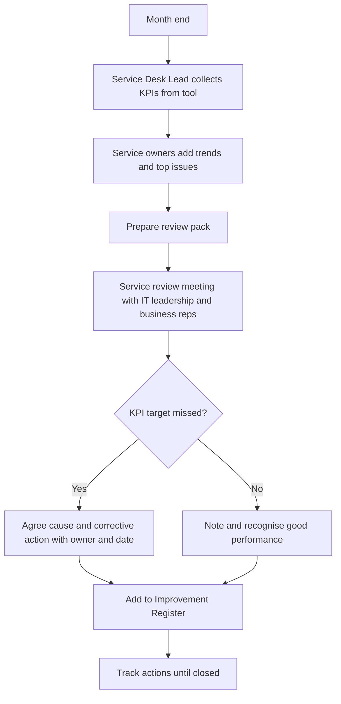
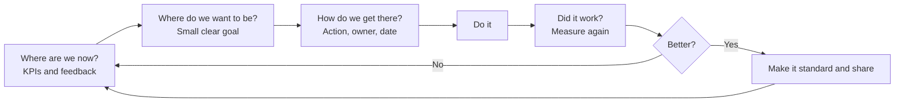
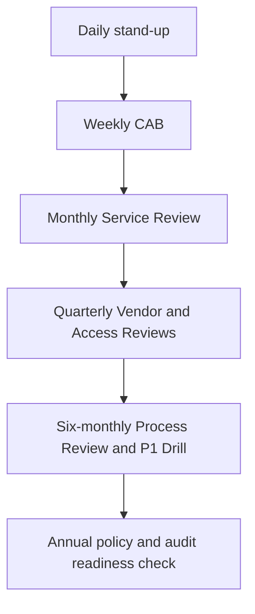

# 8. Governance, Roles, KPIs and Continual Improvement

> **Purpose:** Make sure the process is owned, measured, and getting better, not just written down.

---

## 8.1 Key Roles

| Role | What They Do |
|------|--------------|
| **Head of IT / IT Service Owner** | Accountable for IT service delivery and this standard |
| **Process Owner** (one per process) | Owns the design and performance of a process |
| **Service Owner** | Accountable for a specific service (email, ERP, network) |
| **Service Desk Lead** | Runs the front line and ticket quality |
| **Incident Manager** | Coordinates major incidents |
| **Change Manager** | Runs change enablement and CAB |
| **Problem Manager** | Drives root cause analysis |
| **IT Asset Manager** | Hardware and software lifecycle and compliance |
| **Security Lead / CISO** | Security review and incident involvement |
| **Procurement / Finance Partner** | Purchasing, vendors, budget |

> In small teams one person may hold several roles. What matters is that **someone is named for each**.

## 8.2 RACI Summary

R = Responsible, A = Accountable, C = Consulted, I = Informed

| Activity | Service Desk | IT Lead | Service Owner | Security | Procurement / Finance | Business |
|----------|:-:|:-:|:-:|:-:|:-:|:-:|
| Log and triage tickets | R | A | I | | | |
| Approve standard request | I | C | A | C | | R (manager) |
| Purchase hardware / software | I | A | C | C | R | C |
| Onboard a new vendor | | A | C | R | R | I |
| Manage P1 incident | R | A | R | C | | I |
| Approve normal change | I | R | A | C | | C |
| Post-incident review | C | A | R | C | | I |
| Access review | C | R | A | C | | R |
| Contract renewal | | R | A | C | R | C |

---

## 8.3 Key Performance Indicators

| Area | KPI | Example Target |
|------|-----|----------------|
| **Service Desk** | First contact resolution | 60% or above |
| | Customer satisfaction | 90% or above |
| | Average speed to answer | Within 60 seconds |
| **Incidents** | P1 SLA met | 95% or above |
| | P1 count per month | Trending down |
| | Mean time to restore (MTTR) | Trending down |
| | Reopened incidents | Below 5% |
| **Requests** | Fulfilled within SLA | 90% or above |
| | Approval turnaround | Within 48 business hours |
| **Change** | Change success rate | 95% or above |
| | Emergency changes | Below 5% of total |
| | Unauthorised changes | Zero |
| **Problem** | Root cause found for P1 | 100% within 10 business days |
| | Repeat incidents | Trending down |
| **Procurement** | Purchases with correct approvals and quotes | 100% |
| | Vendors with up-to-date review | 100% of critical and high |
| **Assets** | Register accuracy (audit) | 98% or above |
| | Licence compliance | 100% |
| **Knowledge** | Tickets resolved using articles | Trending up |

---

## 8.4 Review Cadence

| Meeting | Frequency | Participants | Focus |
|---------|-----------|--------------|-------|
| Daily stand-up | Daily | Service Desk and support teams | Queue, P1 and P2 status, blockers |
| CAB | Weekly | Change Manager, IT leads, Security | Upcoming changes |
| Service Review | Monthly | IT leadership, service owners, business reps | KPIs, trends, top issues, improvement actions |
| Vendor Review | Quarterly | Procurement, IT, Finance | Critical vendor performance, renewals |
| Access Review | Quarterly | Application owners, Security | Privileged and sensitive access |
| Process Review | Every 6 months | Process owners | Update this repository |
| Major Incident Drill | Twice a year | Incident team | Practise P1 response |

---

## 8.5 Continual Improvement

Use a simple loop:

1. **Where are we now?** Check the KPIs and user feedback.
2. **Where do we want to be?** Set a clear, small goal.
3. **How do we get there?** Create an action with an owner and date.
4. **Did it work?** Measure again and share the result.

Keep an **Improvement Register** with every idea, owner, status, and outcome. Aim to deliver **one meaningful improvement a month**.

---

## 8.6 Compliance and Audit Readiness

- Every ticket, approval, and purchase leaves a trail
- Policies reviewed at least annually
- Prepare evidence for audits (ISO 27001, SOC 2, internal audit) from the tool, not from memory
- Report significant findings to leadership with an action plan

---

## 8.7 Flowcharts

### A. Monthly Service Review

### B. Continual Improvement Loop

### C. Review Cadence Overview

