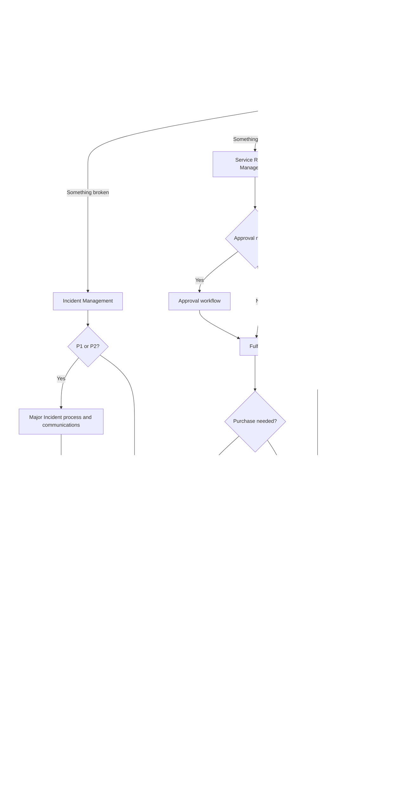
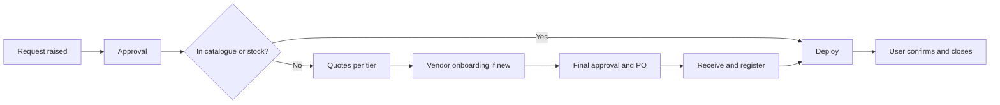
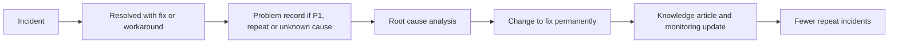
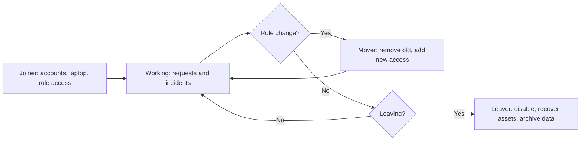

# 9. End-to-End Process Flows (Visual Index)

> **Purpose:** One page to see how everything connects. Use this to explain the model to new team members, auditors, and business leaders. Each flow links to the document where the detail lives.

---

## 9.1 Master Flow: How Every Ticket Travels

---

## 9.2 Request to Purchase to Deployment (Hardware or Software)

See: [01 Service Request](01-service-request-management.md), [02 Procurement](02-procurement-and-vendor-onboarding.md)

## 9.3 Incident to Problem to Change to Knowledge

See: [03 Incident](03-incident-management.md), [05 Problem](05-problem-and-knowledge-management.md), [04 Change](04-change-enablement.md)

## 9.4 Employee Lifecycle

See: [06 JML and Access](06-joiner-mover-leaver-and-access.md)

---

## 9.5 Flowchart Index

| Process | Flowcharts Included | Where |
|---------|--------------------|-------|
| **Service Requests** | Request flow, request vs incident vs change, approval workflow, priority and SLA, new hardware, new software | [01](01-service-request-management.md) |
| **Procurement** | Purchase flow, quote rule decision, quote evaluation, single source, goods receipt and payment, vendor onboarding, contract renewal, asset lifecycle | [02](02-procurement-and-vendor-onboarding.md) |
| **Incident** | Standard flow, priority setting, P1 detailed flow, escalation timeline, communication sequence, security incident, PIR | [03](03-incident-management.md) |
| **Change** | Change type decision, standard, normal, emergency, CAB meeting, failed change and rollback | [04](04-change-enablement.md) |
| **Problem and Knowledge** | Problem trigger, root cause flow, knowledge article lifecycle | [05](05-problem-and-knowledge-management.md) |
| **JML and Access** | Joiner, mover, leaver, access request, access review | [06](06-joiner-mover-leaver-and-access.md) |
| **Communication** | Channel selection, maintenance comms, vendor SLA breach | [07](07-communication-and-escalation.md) |
| **Governance** | Monthly review, improvement loop, review cadence | [08](08-governance-roles-and-kpis.md) |
