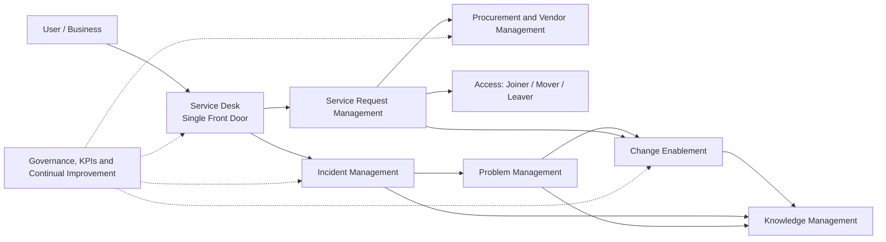

# IT Service Management Standard (ITIL 4 Aligned)

> A practical, ready-to-adopt blueprint for running IT the way mature organisations do it: clear ownership, clear approvals, clear communication, and no surprises.

---

## A Quick Word From Me

I have spent my career leading IT teams inside large, well-known, Class A corporate organisations. I have been the person on the bridge call at 2 AM during a P1, the person defending a hardware budget in front of Finance, and the person who had to explain to a CEO why a "small change" took down a customer-facing system.

Across all of those years, one lesson keeps repeating: **good IT is rarely about the best tool or the smartest engineer. It is about a simple, well-understood process that everyone follows, even when things get stressful.**

This repository is that process, written down in plain language. It is what I would put in place if I were handed a blank page and asked to build IT from scratch. It follows **ITIL 4** principles, but I have deliberately kept it human and practical. You will not need a certification to read it, and you will not need a big team to run it.

Take it, copy it, break it, adapt it. If it saves you even one bad night, it has done its job.

---

> **Every process in this repository includes flowcharts.** Start with the [End-to-End Process Flows](docs/09-end-to-end-process-flows.md) for the big picture, then open each process for the detailed flows.

---

## Guiding Principles

1. **Focus on value.** Every process exists to help the business, not to create paperwork.
2. **Start where you are.** Adopt in phases. A 50-person company and a 5,000-person company can use the same foundation with different levels of rigour.
3. **Keep it simple.** If a step does not add control, speed, or clarity, remove it.
4. **Make it visible.** If it is not in a ticket, it did not happen.
5. **Communicate early, communicate honestly.** Silence during an incident is always worse than bad news.
6. **Separate duties.** The person who requests, approves, buys, and pays should never be one person.
7. **Always learn.** Every incident, change, and purchase should leave us a little better.

---

## Process Map

---

## Contents

| # | Document | What it covers |
|---|----------|----------------|
| 1 | [Service Request Management](docs/01-service-request-management.md) | Every type of request, approval flow, fulfilment, SLAs |
| 2 | [Procurement and Vendor Onboarding](docs/02-procurement-and-vendor-onboarding.md) | Hardware and software purchase, the 3-quote rule, vendor due diligence, renewals |
| 3 | [Incident Management](docs/03-incident-management.md) | P1 to P4 definitions, escalation, war room, communication channels, post-incident review |
| 4 | [Change Enablement](docs/04-change-enablement.md) | Standard, normal and emergency changes, CAB, rollback |
| 5 | [Problem and Knowledge Management](docs/05-problem-and-knowledge-management.md) | Root cause analysis, known errors, knowledge articles |
| 6 | [Joiner, Mover, Leaver and Access](docs/06-joiner-mover-leaver-and-access.md) | Employee lifecycle, access approvals, asset recovery |
| 7 | [Communication and Escalation Standard](docs/07-communication-and-escalation.md) | Channels, templates, who to tell and when |
| 8 | [Governance, Roles, KPIs and Review](docs/08-governance-roles-and-kpis.md) | RACI, metrics, review cadence, continual improvement |
| 9 | [End-to-End Process Flows](docs/09-end-to-end-process-flows.md) | Master flowchart, visual index of every flow in this repository |

---

## Scaling This to Your Size

The same flows work for everyone. What changes is **how many people sit in each role** and **how strict the thresholds are**.

| Area | Small (up to ~200) | Mid-size (~200 to 2,000) | Large (2,000+) |
|------|--------------------|--------------------------|----------------|
| Service Desk | 1 to 3 people, shared duties | Dedicated desk plus L2 | L1/L2/L3, follow-the-sun |
| Change approval | IT Lead plus one peer | Weekly CAB | CAB plus eCAB, domain boards |
| Procurement | IT Lead plus Finance | Procurement team involved | Formal sourcing, legal, vendor risk |
| Vendor review | Lightweight checklist | Risk-tiered review | Full third-party risk programme |
| Incident roles | One person wears several hats | Defined Incident Manager | Major Incident team, comms lead |

> **Tip:** Money thresholds in this repository are written as examples (in USD-equivalent). Replace them with values that suit your company's currency and budget culture.

---

## How to Roll This Out (Suggested Order)

1. **Weeks 1 to 2:** Set up the single front door (service desk or ticketing tool), define priorities (P1 to P4), and agree the communication channels.
2. **Weeks 3 to 4:** Publish the request catalogue and approval matrix. Start tracking everything in tickets.
3. **Month 2:** Introduce change enablement and the procurement and vendor flow.
4. **Month 3:** Start problem management, knowledge articles, and the first monthly service review.
5. **Ongoing:** Review KPIs, run post-incident reviews, and improve one thing every month.

---

## Glossary (Plain English)

- **Incident:** Something that was working and now is not (or is working badly).
- **Service Request:** Someone asking for something that is a normal, expected part of IT service.
- **Problem:** The underlying cause behind one or more incidents.
- **Change:** Anything that adds, modifies, or removes something that could affect IT services.
- **CAB:** Change Advisory Board. A small group that reviews risky changes.
- **SLA:** The time we promise to respond and resolve.
- **CMDB / Asset Register:** The record of what we own and how it connects.
- **MSA / NDA / DPA:** Master Service Agreement, Non-Disclosure Agreement, Data Processing Agreement.

---

## Contributing

Found a gap? Have a better way? Open an issue or raise a pull request. Process documents should be living documents, reviewed at least **twice a year**.

---

*Document owner: Head of IT / IT Service Owner*
*Version: 1.0*
*Review cycle: Every 6 months*
